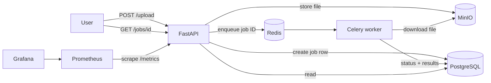
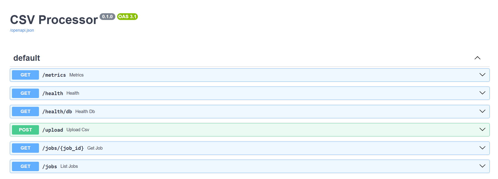
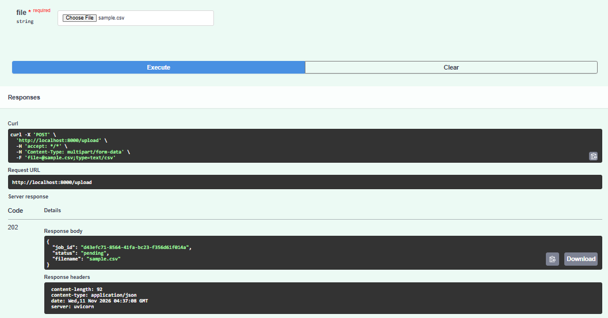
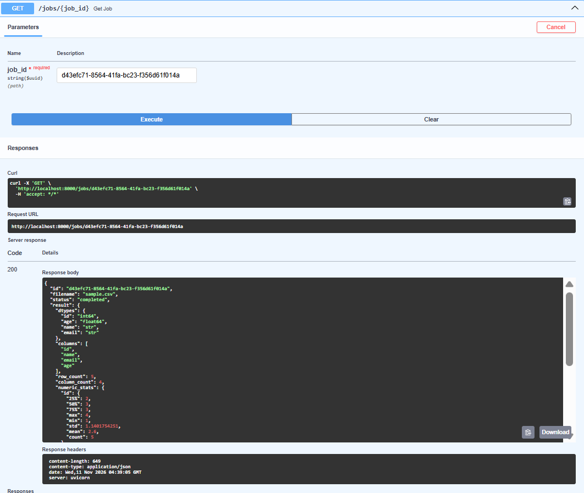
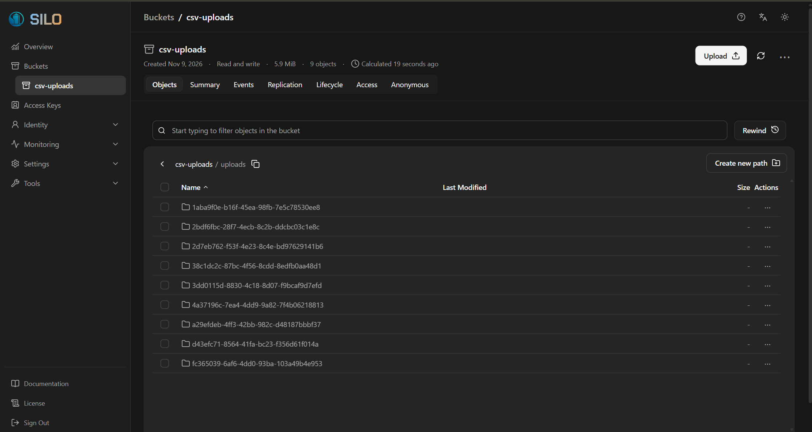
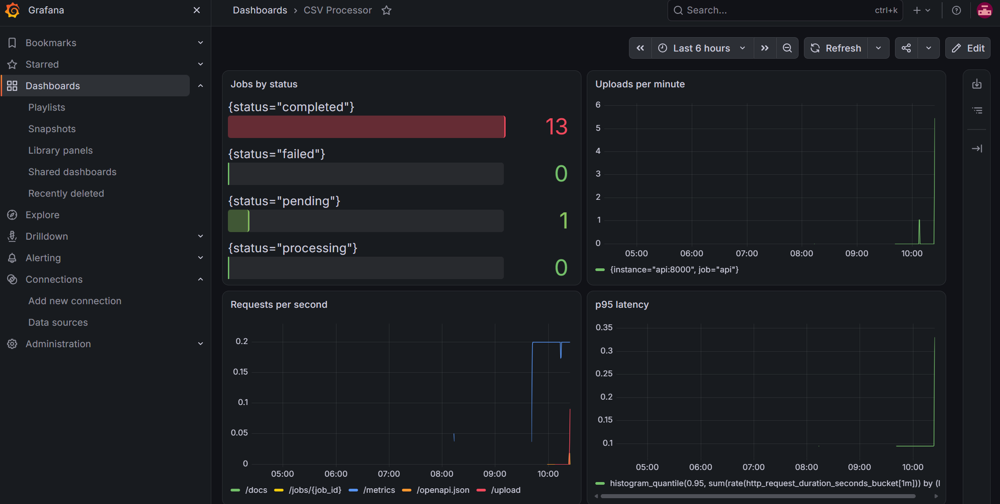
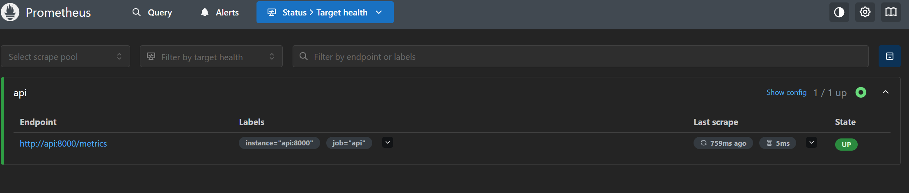
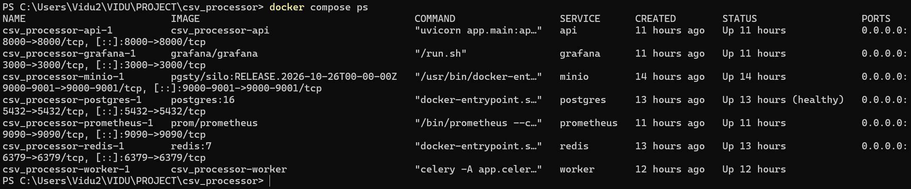
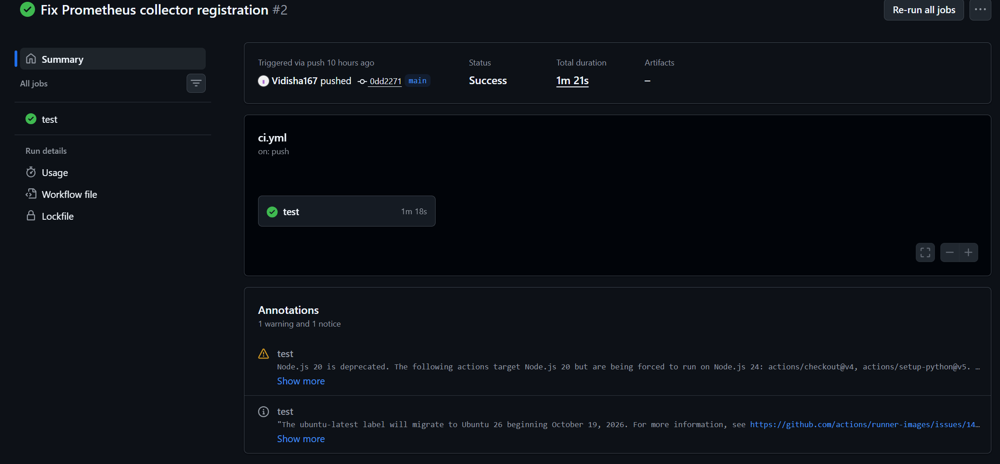

# CSV Processor

An asynchronous file-processing platform. Users upload large CSV files, the API responds immediately with a job ID, and a background worker analyzes the file (row count, missing values, duplicates, column statistics). Users poll the API for status and results.

## Architecture



## Demo

### API documentation


### Uploading a CSV returns instantly with a job ID


### Retrieving the processed result


### Uploaded files stored in MinIO (S3-compatible)


### Monitoring with Prometheus and Grafana



### All services running in Docker Compose


### CI on every push (GitHub Actions)


## Tech stack

| Component | Role |
|---|---|
| FastAPI | Upload and job status/results APIs |
| Celery + Redis | Background job queue and workers |
| MinIO | S3-compatible object storage for uploaded files |
| PostgreSQL | Job metadata, status and results (JSONB) |
| pandas | CSV analysis |
| Prometheus + Grafana | Metrics and dashboards |
| Docker Compose | Runs all services locally |
| GitHub Actions | Runs tests and a Docker build on every push |

## How it works

1. The user uploads a CSV to `POST /upload`.
2. The API streams the file to MinIO, creates a job row (`pending`) and queues the job ID in Redis.
3. The API returns `202 Accepted` with the job ID right away.
4. A Celery worker picks up the job, marks it `processing`, downloads the file and analyzes it with pandas.
5. The worker stores the results and marks the job `completed`, or `failed` with the error message.
6. The user polls `GET /jobs/{job_id}` for status and results.

## Quick start

```bash
git clone https://github.com/Vidisha167/csv_processor.git
cd csv_processor
cp .env.example .env        # Windows PowerShell: Copy-Item .env.example .env
docker compose up -d --build
```

| Service | URL |
|---|---|
| API docs | http://localhost:8000/docs |
| MinIO console | http://localhost:9001 |
| Prometheus | http://localhost:9090 |
| Grafana | http://localhost:3000 |

Default logins are for local development only (see `docker-compose.yml`).

## API

| Endpoint | Description |
|---|---|
| `POST /upload` | Upload a CSV. Returns `202` with a `job_id` |
| `GET /jobs/{job_id}` | Status (`pending`, `processing`, `completed`, `failed`) and results |
| `GET /jobs?status=completed` | List recent jobs, optionally filtered by status |
| `GET /metrics` | Prometheus metrics |

## Tests

```bash
docker compose exec api python -m pytest -v
```

Covers the analysis logic and the API, with storage and queue mocked. CI runs them against a Postgres service on every push.

## Design decisions

- **Async processing:** uploads return in milliseconds, and workers scale independently (`docker compose up -d --scale worker=3`).
- **Results in Postgres instead of a Celery backend:** one durable, queryable source of truth for job status.
- **`task_acks_late`:** a job is re-queued if a worker dies mid-task.
- **S3 API via MinIO:** the same code would work against AWS S3.

## Limitations and next steps

- Whole files are loaded into memory; multi-GB files would need chunked reads.
- Tables are created with `create_all`; a real deployment would use Alembic migrations.
- No authentication or upload size limit yet.
- Stale `pending` jobs are not re-queued automatically.